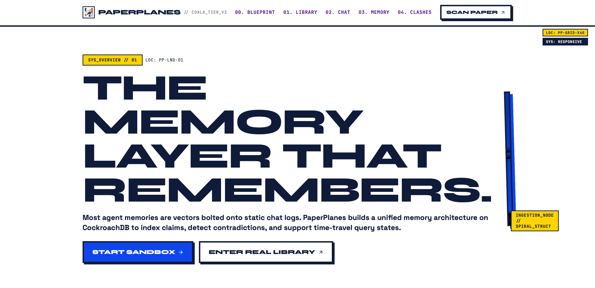
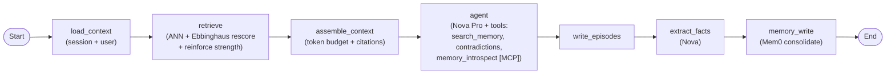
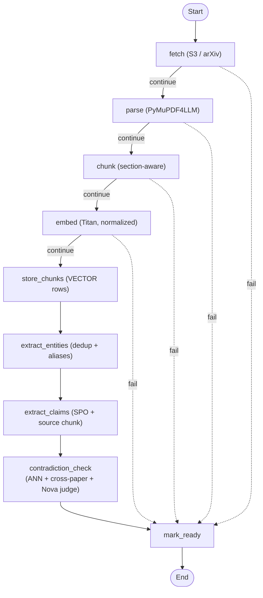
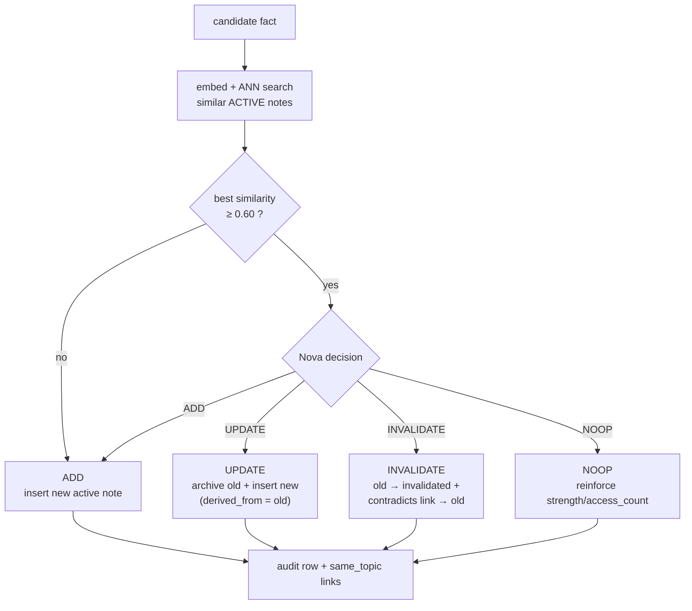

<p align="center"></p>

<h1 align="center">PaperPlanes</h1>

<p align="center"><strong>A research companion that remembers what it read, built on CockroachDB.</strong></p>

<p align="center">
  Feed it papers (PDF or arXiv). It extracts entities and claims, links ideas across papers,
  tracks your open questions across sessions, and keeps both claims when two papers disagree.
  Its memory lives in CockroachDB, and the tests below show what a flat file would lose.
</p>

<p align="center">
  
  
  
  
  
</p>

<p align="center">
  Built for the <a href="https://cockroachdb-ai.devpost.com/">CockroachDB × AWS "Build with Agentic Memory" hackathon</a>.
</p>

<p align="center">
  
</p>

---

## Results

Each line has a script or test in this repo.

- **0 writes lost under contention.** 25 concurrent writers increment one counter. A flat-file / in-memory dict analog kept **1 / 25**; CockroachDB kept **25 / 25**, with **58 SERIALIZABLE conflicts detected and retried**. `app.scripts.demo_concurrency`
- **Retrieval stays on the index at ~10,000 notes.** `EXPLAIN ANALYZE` resolves the retrieval query with a **C-SPANN `vector search`** on `notes_embedding_idx` (**~15 ms** step), not a full scan. `app.scripts.seed_scale --explain`
- **Real papers through the full pipeline.** 4 arXiv papers yielded **424 extracted claims** (NCF 96, Dacrema 178, RHN 89, Melis 61) through parse, embed, claim extraction and contradiction check.
- **171 tests.** **10 / 10** live integration tests assert on the rows CockroachDB actually holds (`memory_notes`, `claims`, `contradictions`, `reflections`; real Bedrock, real SQL, no mocks), and the memory-eval suite passes **4 / 4** probes.

## Could you just use a flat file?

| Property | Flat file / in-memory dict | CockroachDB (PaperPlanes) | How it's checked |
| :--- | :--- | :--- | :--- |
| **25 concurrent writers, 1 counter** | **1 / 25** survive, 24 updates silently lost | **25 / 25** survive, 58 serialization conflicts detected and retried | `app.scripts.demo_concurrency` (SERIALIZABLE + `run_transaction`) |
| **ANN over ~10⁴ memory notes** | O(n) full scan | **C-SPANN vector index**: `EXPLAIN` shows `vector search` on `notes_embedding_idx` (~15 ms step) | `app.scripts.seed_scale --explain` |
| **"What did you believe at time T?"** | unanswerable | `as_of` reconstructs the superseded value from `created_at`/`expired_at` | live integration suite |
| **Multi-user isolation** | manual | real `users` rows + `user_id`-scoped vector index prefix | live integration suite |

---

## How memory works

Contradicted knowledge is versioned out with `invalid_at`/`expired_at`, never deleted, so you can ask what the agent believed at time T (`as_of`) and see it change its mind in the audit log. When two papers disagree, both claims stay `disputed`; neither wins by default.

The design combines mechanisms from six memory papers:

| Mechanism | Source | What it does here |
|---|---|---|
| Bi-temporal facts (`valid_at`/`invalid_at` + txn time) | **Zep** | Contradicted knowledge is invalidated, never deleted; point-in-time (`as_of`) queries + full audit history |
| ADD / UPDATE / INVALIDATE / NOOP write path | **Mem0** | New facts are consolidated against existing memory, not appended |
| Linked memory notes | **A-MEM** | Notes carry keywords/tags/context and LLM-refined `same_topic`/`contradicts` links |
| recency × importance × relevance retrieval, Ebbinghaus decay | **Generative Agents / MemoryBank** | Memories strengthen when accessed, fade when neglected |
| Async reflection ("sleep-time compute") | **Letta** | Background worker distills episodic memory into cited insights |
| Working / episodic / semantic / procedural tiers | **CoALA** | All four tiers live in one CockroachDB cluster |

### Stack

- **Memory**: CockroachDB Cloud. Vector indexes (C-SPANN, `VECTOR(1024)`), Managed MCP Server (read-only SQL introspection), LangGraph checkpoints via `langchain-cockroachdb`, bi-temporal schema, recursive-CTE graph traversal.
- **Agents**: LangGraph + FastAPI (Python 3.12). Amazon **Nova Pro** (chat + claim extraction), **Nova Lite** (fast decision/judge), **Titan Text Embeddings V2** (1024-dim), all via **Amazon Bedrock**.
- **AWS**: Bedrock, S3 (PDF storage), EC2 (deployment).
- **Frontend**: React 19 + Vite. Chat, Library, Memory Inspector (timeline / diff / graph), Contradictions.

> Nova is a config swap (`BEDROCK_CHAT_MODEL_ID` / `BEDROCK_FAST_MODEL_ID`). Amazon's first-party models bill through standard AWS consumption; Anthropic models on this account route through Bedrock Marketplace (card-gated), so Nova is the default.

### Graphs

Two compiled LangGraph pipelines. Each node degrades on its own (no AWS creds, no retrievable context, an unreachable DB), so one compiled graph runs from CI to production.

**Chat: retrieve, reason, consolidate.** The user only waits on `agent`. `write_episodes → extract_facts → memory_write` run after the reply is produced.



**Ingestion: PDF to claims to contradictions.** Every pre-storage step goes through a `continue / fail` guard that short-circuits to `mark_ready` (writing `status='failed'`). The extraction steps degrade instead, so a paper always reaches a terminal state.



**Mem0 write path.** For each candidate fact: embed, ANN-search similar active notes, and if one is close enough, ask Nova to pick one of four branches. The decision happens before any row changes, so no transaction is held open across an LLM call.



### The code that does the work

<table>
<tr><td width="50%" valign="top">

**`memory/writer.py`**: the Mem0 decision

The common case skips the LLM. The decision runs before any row changes.

```python
best = cos(similar[0]) if similar else -1.0
if not similar or best < ADD_SIMILARITY_THRESHOLD:
    return await self._apply_add(...)   # new → skip LLM

decision = await self._decide(candidate, similar)
# → ADD / UPDATE / INVALIDATE / NOOP
```

Nova sometimes returns a `note_id` we never offered. We drop it instead of trusting it:

```python
valid_ids = {n["id"] for n in similar}
target_id = (decision.note_id
             if decision.note_id in valid_ids else None)
```

</td><td width="50%" valign="top">

**`memory/scoring.py`**: pure, no I/O, unit-tested

The forgetting curve and spaced-repetition reinforcement.

```python
def ebbinghaus_retention(dt, S):     # R = e^(−Δt/S)
    if S <= 0:  return 0.0
    if dt <= 0: return 1.0
    return math.exp(-dt / S)

def reinforce(S, access_count):      # S·(1 + 1/(n+1))
    return S * (1 + 1 / (access_count + 1))
    # 1st access ~doubles S, then diminishing
```

One function converts an ANN distance to similarity, so `writer` (dedup) and `retriever` (relevance) always agree:

```python
def l2_to_cosine(d):     # unit vecs: ‖a−b‖²=2−2·cos
    return clamp(1.0 - d * d / 2.0, -1.0, 1.0)
```

</td></tr>
<tr><td width="50%" valign="top">

**`memory/db/retry.py`**: why 25/25 writers survive

CockroachDB aborts contended `SERIALIZABLE` txns with `SQLSTATE 40001`. Every write path retries here with exponential backoff and full jitter, only on that error.

```python
for attempt in range(max_attempts):
    try:
        return fn()
    except Exception as exc:
        if not _is_retryable(exc):   # only 40001
            raise
        sleep(random.uniform(
            0, min(max_delay, base_delay * 2**attempt)))
```

</td><td width="50%" valign="top">

**`memory/db/notes_repo.py`**: bi-temporal `as_of`

`list_notes(as_of=T)` rebuilds transaction-time state at any instant `T`.

```sql
WHERE created_at <= :as_of
  AND (expired_at IS NULL OR expired_at > :as_of)
ORDER BY valid_at DESC
```

A superseded note keeps its row with `expired_at` stamped, so history stays queryable.

</td></tr>
</table>

---

## Live tests (real rows)

`backend/tests/integration/test_core_features_live.py` runs **10 tests against a live CockroachDB and real Bedrock** (Titan + Nova), each under a throwaway user, each asserting on the rows written.

| Feature | What the test forces | What CockroachDB contains after |
| :--- | :--- | :--- |
| **Mem0 ADD** | brand-new fact, no similar note | 1 `active` `VECTOR(1024)` row + `add` audit |
| **Mem0 NOOP** | identical duplicate | **no new row**; `strength 1.0 → 2.0`, `access_count 0 → 1` |
| **Mem0 UPDATE** | "10,000 examples" → "50,000" | old `archived` + `expired_at`; new active carries `derived_from = [old]` |
| **Mem0 INVALIDATE** | "90% acc" → "55%, 90% was wrong" | old `invalidated` + `invalid_at`; real `contradicts` link new → old |
| **Mem0 decision (real Nova)** | 72% → 26% contradiction, no injection | Nova returns a branch; every non-active row correctly time-stamped |
| **Bi-temporal `as_of`** | write, wait, supersede | `as_of=before` → old value; `as_of=now` → new value; old row retained |
| **Contradiction detection** | two real papers' verbatim same-subject claims | `contradictions` row + **both claims `disputed`** (both retained) + rationale |
| **Reflection worker** | 5 real notes, manual trigger | 3 reflections; **every stored citation resolves to a real input note** (made-up ids dropped) |
| **Decay pass** | an aged, low-strength note | retention `0.0 < 0.05` → note `archived` + `archive` audit |
| **Scoring / decay** | 2 real retrievals of one note | `strength 1.0 → 2.0 → 3.0` **persisted**, 2 `read` audit rows |

Plus: `tests/eval/` memory probes pass **4 / 4** (knowledge update, temporal point-in-time, cross-session decision-driving, abstention), and the unit suite covers scoring math, the writer's four branches, retry logic and auth.

<details>
<summary><strong>Sample output from a live run</strong></summary>

```ansi
1b. Mem0 NOOP: duplicate fact reinforces the existing note (real rows)
  seeded note: {'strength': 1.0, 'access_count': 0}
  writer result: [{'action': 'noop', ...}]
  DB AFTER -> note count: 1 (no new row inserted)
  DB AFTER -> strength: 1.0 -> 2.0 | access_count: 0 -> 1

1d. Mem0 INVALIDATE: old note invalidated + contradicts link written
  DB AFTER -> old note status: invalidated | invalid_at set: True
  DB AFTER -> contradicts link: contradicts  new -> old

2. Bi-temporal as_of: old value retrievable at old time, gone at new time
  as_of=...:35 (BEFORE supersession) -> ['Paper Y ... converges in 100 iterations.']
  as_of=...:37 (NOW)                  -> ["Paper Y's method ... requires 5,000 iterations."]

3. Contradiction detection: real, citable arXiv disagreement
  Paper B (1708.05031): Neural collaborative filtering substantially outperforms ... baselines.
  Paper A (1907.06902): Well-tuned baselines outperform ... neural collaborative filtering ...
  node returned contradictions: 1
  DB AFTER -> claim A status: disputed | claim B status: disputed

5. Scoring/decay: retrieval reinforces strength and PERSISTS it to the DB
  strength trajectory across accesses (read back from DB each time): [1.0, 2.0, 3.0]
```
</details>

---

## Contradiction detection, and where it stops working

Ingestion extracts SPO claims per paper. For each new claim it ANN-searches existing active claims from other papers and has Nova judge near matches. On a `contradicts` verdict, **both** claims are flagged `disputed` (retained) and a `contradictions` row is written; resolving it is left to you.

Tested on real arXiv papers through the full pipeline:

- **Same-subject conflicting claims**: detected end to end (the test above).
- **Two independently written papers that disagree on a theme**: often *not* detected. NCF (1708.05031, 96 claims) vs Dacrema (1907.06902, 178 claims) name different specific systems. RHN (1607.03474, 89 claims) vs Melis (1707.05589, 61 claims) share the subject (RHN perplexity on Penn Treebank), but their extracted phrasings land at cosine **0.49 to 0.52**, below the 0.60 candidate floor tuned for near-paraphrase, so the judge is never called.

So the detector fires when two claims are near-paraphrase conflicts about the same subject. Open-corpus cross-paper detection needs a lower floor or **entity-based candidate matching** (canonical subject/object entities) instead of raw statement embeddings. That limit is recorded in the contradiction test itself.

---

## Self-introspection via CockroachDB MCP

The chat agent has a `memory_introspect` tool wired to the **CockroachDB Managed MCP Server**. For questions like "how many papers this month?" or "what's my biggest memory table?" it writes read-only SQL against its own memory, run through MCP with a service-account key scoped to `mcp:read` (the server rejects anything that isn't a `SELECT`). Every introspection is written to `memory_audit_log`.

---

## Quick start (local)

```bash
cp .env.example .env          # add AWS creds for real LLM calls; echo mode runs without them
docker compose up --build
docker compose exec backend python -m app.scripts.init_db
# open http://localhost/
```

Dev servers: `cd backend && uvicorn app.main:app --reload` · `cd frontend && npm run dev`

Reproduce the results:

```bash
cd backend
# the flat-file comparison
DATABASE_URL="postgresql://root@localhost:26257/defaultdb?sslmode=disable" python -m app.scripts.demo_concurrency
DATABASE_URL="postgresql://root@localhost:26257/defaultdb?sslmode=disable" python -m app.scripts.seed_scale --explain
# the live integration suite (needs live DB + AWS creds)
DATABASE_URL="postgresql://root@localhost:26257/defaultdb?sslmode=disable" \
  python -m pytest tests/integration/test_core_features_live.py -s -v
```

## Repository layout

```text
backend/            FastAPI + LangGraph: app/memory (engine), app/core (graphs/nodes/models),
                    app/api (routes), app/scripts (init_db, seeds, benchmarks), tests/{unit,integration,eval}
frontend/           React 19 + Vite: Landing, Chat, Library,
                    Memory Inspector (timeline/diff/graph/time-travel), Contradictions
docker-compose.yml  single-node CockroachDB v25.2 + backend + frontend
```

## License

MIT. See [LICENSE-MIT](LICENSE-MIT).
